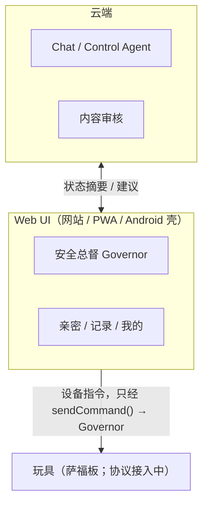

# Nascent

智能情趣玩具的配套软件仓库：AI 陪伴聊天、情景与剧情、自我控制、频率与记录。

**2026-11 起的现状**：硬件是萨福原厂板（配套 App 为轻喃），里面**没有**我们的 ESP32，也没有温度、压力、六轴传感器。本仓库只做软件与体验。旧 Nascent 玩具侧板（ESP32-S3 固件、传感器、BOOT 键、AO3400A 按键模拟）已退役，固件和 datasheet 已从仓库删除，需要时查 git 历史。

- 产品架构（权威副本）：[`docs/architecture/产品架构.md`](docs/architecture/产品架构.md)。文档开头说明了 2026-11 的硬件变更，哪些章节只作历史参考。
- 2026-11 产品方向：[`docs/product-decisions-2026-11.md`](docs/product-decisions-2026-11.md)。
- 最近一次改造的技术说明和审查材料：[`docs/implementation/`](docs/implementation/)。

## 运行结构



- **云端**只产出台词和建议，看不到音频和原始设备数据，也不能直接控制设备。
- **Web UI** 是唯一的设备入口。所有指令都只能走 `sendCommand()` → `Governor`，停止永远可以发。
- **设备接口**：`protocol/` 里仍是旧板的 `Nascent-Toy` 协议。拿到萨福的蓝牙协议之前，App 继续用它，届时整体替换传输层。

## 目录

| 目录 | 内容 |
|---|---|
| [`protocol/`](protocol/) | 设备契约、生成器、JSON Schema（当前为旧板协议 `0.3.0-demo`，待替换） |
| [`software/app/`](software/app/) | Web UI（网站 + PWA），Android 壳加载的也是它 |
| [`software/app-android/`](software/app-android/) | Android 壳：WebView + 原生 GATT 桥 + 心率广播 |
| [`software/backend/`](software/backend/) | FastAPI 后端（同时托管网站） |
| [`www/`](www/) | 官网静态页 |
| [`docs/`](docs/) | 协作规范、架构、产品决策、实施记录 |

## 上手

协作、分支、提交和评审流程见 [`docs/Nascent 开发与代码提交规范.md`](docs/Nascent%20开发与代码提交规范.md)。

```bash
# 协议：改完 contract.yaml 后必须重新生成
cd protocol && python3 tools/gen.py

# 后端 + 网站
cd software/backend
python3 -m venv .venv
source .venv/bin/activate          # Windows: .venv\Scripts\activate
pip install -r requirements.txt
uvicorn app.main:app --reload
# 打开 http://127.0.0.1:8000

# 前端测试
cd software/app && node tests/run.mjs

# Android App：用 Android Studio 打开 software/app-android/，填入同一地址
```

Windows 上开发没有额外步骤：仓库全 ASCII 文件名、`.gitattributes` 锁 LF、生成器显式 UTF-8 读写。唯一要注意的是 venv 激活命令与 macOS/Linux 不同。

## 红线

- **不做医疗器械。** 禁止核心体温、疾病预警、生理周期监测的表述与算法承诺。
- **不做高潮检测。**
- **安全功能永不收费。**
- **音频不上云。** 云端只收脱敏摘要，不收音频和原始设备数据。
- **LLM 不直接出电机指令。** 模型只给语义建议，落地必须经过 `Governor`。
- **停止永远可发，且不能被远程解除。** App、云端、外部 AI 都没有「恢复」指令；不要给 `resume` 加发送入口。
- **断连后不自动恢复原档位。** 重连只读状态，不重放调档。
- **设备侧安全目前取决于萨福固件。** 本地急停、强度上限、断连归零原本由我们的固件保证。接入萨福板后，第一件事是实测它的停止与断连行为，并把结论写进 `docs/architecture/`。
